

# Circle

**Money, friends & deals. In one circle.**

Track every account, split trips and bills with friends, see what an investment really earns each month and work out your Zakat. Everything stays on your phone.

 

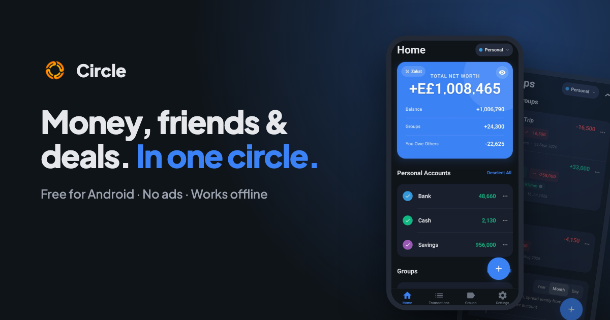

 

## 💼 Accounts — see your whole net worth at a glance

<table>
<tr>
<td width="62%" valign="middle">

Bank, cash, savings, what friends owe you and your share of every group add up to one number. Tick accounts on and off to see exactly the total you care about.

- Personal accounts, people you lend to or borrow from, and groups
- Transfers between accounts, including lending to a friend
- Separate profiles to keep, say, personal and business apart

</td>
<td width="38%" align="center">
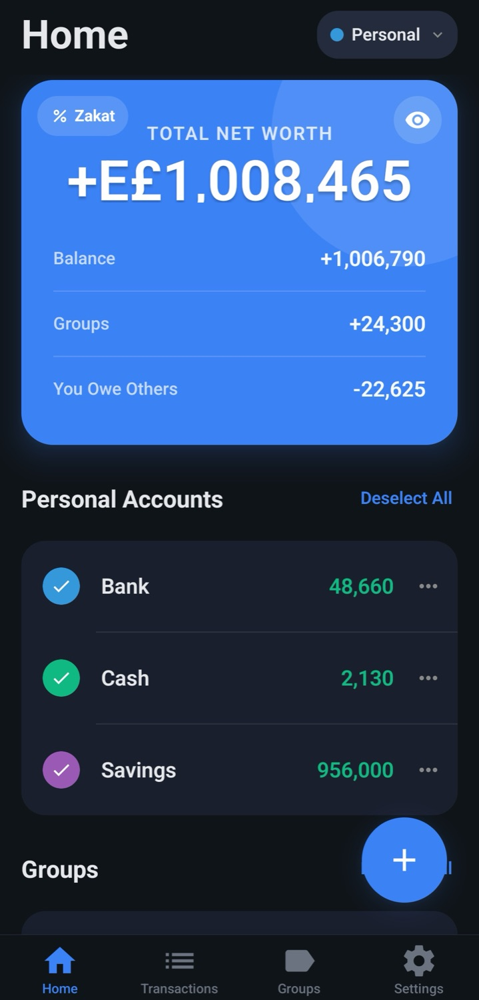
</td>
</tr>
</table>

## 👥 Groups — split trips, bills and investments fairly

<table>
<tr>
<td width="38%" align="center">
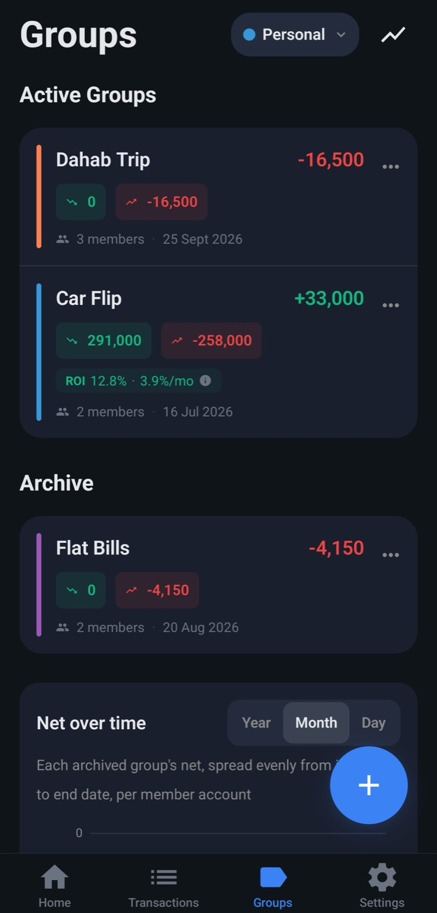
</td>
<td width="62%" valign="middle">

Add friends to a group, give each one a share, and record who paid. Circle keeps track of who owes whom, so nobody has to do the maths after the trip.

- Uneven shares, like 2 : 1 for a joint investment
- Return on investment for groups that earn money
- Archive finished groups and chart their net over time

</td>
</tr>
</table>

## 📈 Deals — know which deal really earns more

<table>
<tr>
<td width="62%" valign="middle">

A quick flip can beat a big profit. Enter a cost, a sale price and how many months it takes, and Circle ranks your options by their compounded monthly return.

- Compare as many deals as you like, side by side
- Simulate a sale price and see each partner's payout per month and per day
- Tap any return to see exactly how it was worked out

</td>
<td width="38%" align="center">
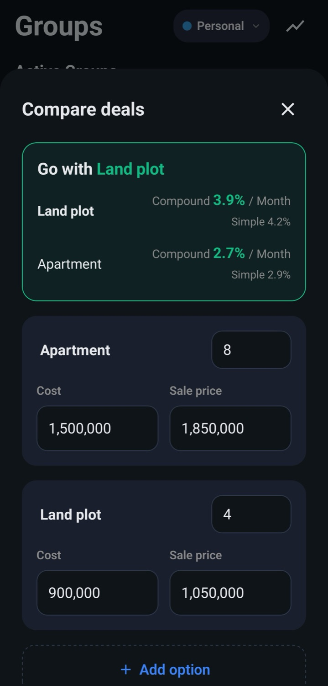
</td>
</tr>
</table>

## 🌙 Zakat — worked out for you

<table>
<tr>
<td width="38%" align="center">
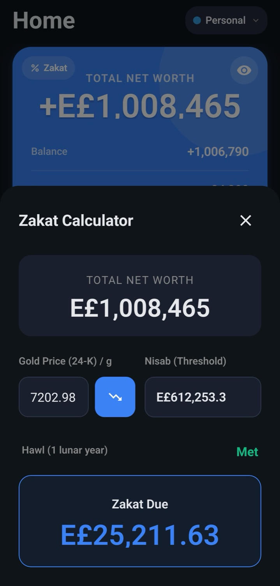
</td>
<td width="62%" valign="middle">

Circle fetches today's gold price, sets the Nisab and checks whether your wealth stayed above it for a full lunar year. If Zakat is due, you see the amount, minus anything you have already paid.

- Live 24K gold price, or enter your own
- Hawl checked against your real history
- Choose which accounts and groups count

</td>
</tr>
</table>

## 🗓️ Everyday — bills that remind you, not the other way round

<table>
<tr>
<td width="62%" valign="middle">

Set rent, subscriptions and salary to repeat. Circle reminds you on the day, and one tap approves or skips them. Templates and a built-in calculator keypad make adding anything else quick.

- Daily, weekly, monthly or yearly, on the days you pick
- Filter by account, category or date and see the totals
- Attach receipts, and add from a home screen widget

</td>
<td width="38%" align="center">
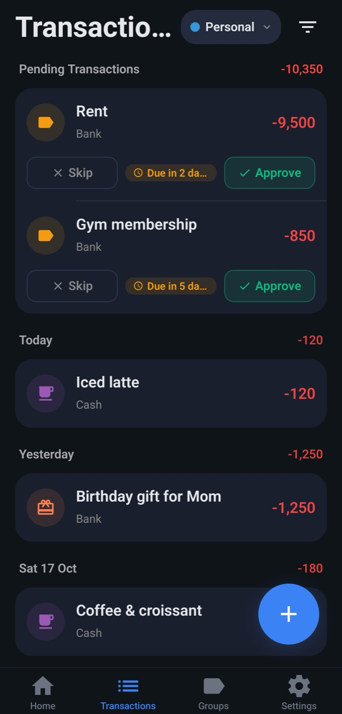
</td>
</tr>
</table>

## 💬 Bank messages — your bank's texts, turned into transactions

<table>
<tr>
<td width="38%" align="center">
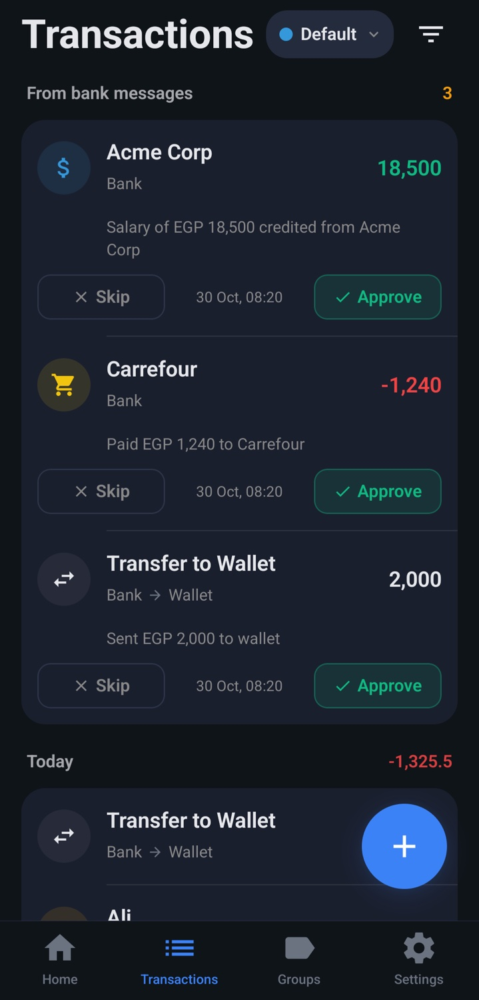
</td>
<td width="62%" valign="middle">

Pick the sender your bank texts from and show Circle how its messages read. When a matching text arrives, even with the app closed, it waits as a pending transaction, and one tap records it.

- Start a template from a real message, then mark the `{amount}` and `{name}`
- Expenses, income and transfers, with a transfer both banks text about kept once
- Read on your phone only; codes and offers from the bank are never kept

</td>
</tr>
</table>

## ✨ And the things you'd expect

| | | |
|:---:|:---:|:---:|
| 📴 **Offline first** Your data lives on your phone. No sign-up, no internet needed. | 💾 **Automatic backups** Back up to a folder you choose on a schedule, and restore any time. | 📊 **Excel export** Export your accounts to a spreadsheet and analyse them your way. |
| 🔒 **App lock** Fingerprint, face or passcode, and hidden from the app switcher. | 👁 **Hide amounts** Blur every number with one tap when someone's looking over your shoulder. | 🚫 **No ads, ever** A clean app with nothing to sell you. |

## 📱 A look inside

<table>
<tr>
<td align="center">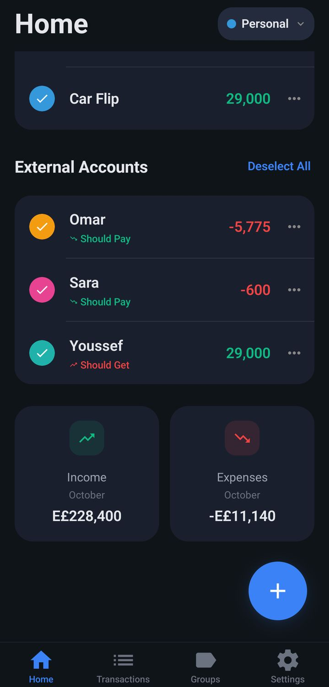 <b>Home</b></td>
<td align="center"> <b>Transactions</b></td>
<td align="center"> <b>Groups</b></td>
<td align="center">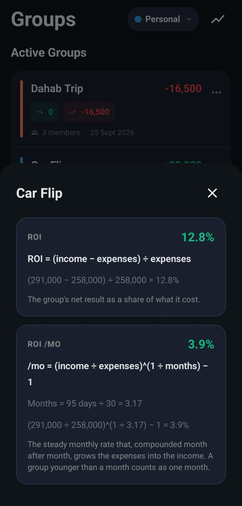 <b>Return, explained</b></td>
</tr>
<tr>
<td align="center"> <b>Compare deals</b></td>
<td align="center">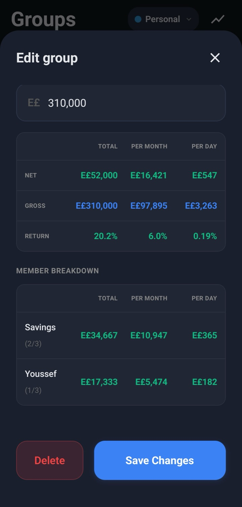 <b>Income simulator</b></td>
<td align="center"> <b>Zakat</b></td>
<td align="center">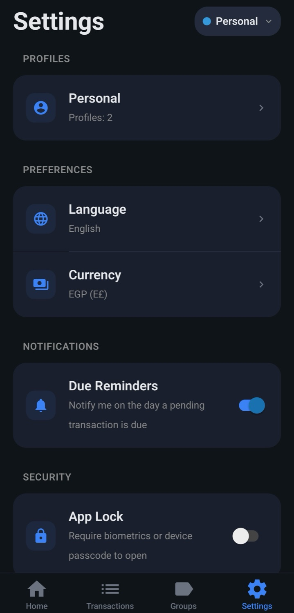 <b>Settings</b></td>
</tr>
</table>

## ⬇️ Get Circle

1. **[Download the APK](https://github.com/Mohamed-Fathy-Salah/circle-releases/releases/latest/download/circle.apk)** on your Android phone.
2. Open it and allow installing from your browser if asked.
3. That's it — no account needed. You're set up in a minute.

 

### Ready to close the circle?

Questions or ideas? <a href="mailto:mohamedfathy29908@gmail.com">Send an email</a> · Enjoying Circle? <a href="https://buymeacoffee.com/mofasa">Buy me a coffee ☕</a>

